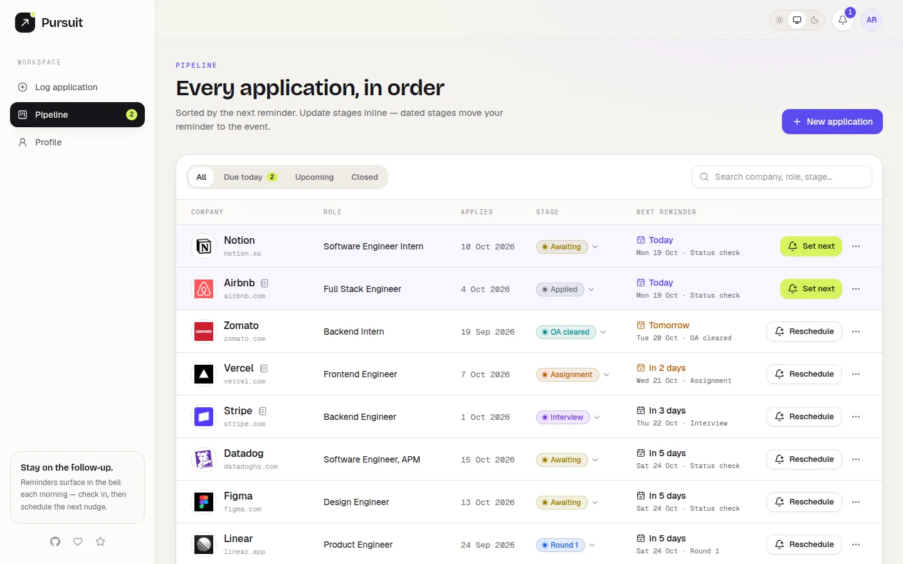
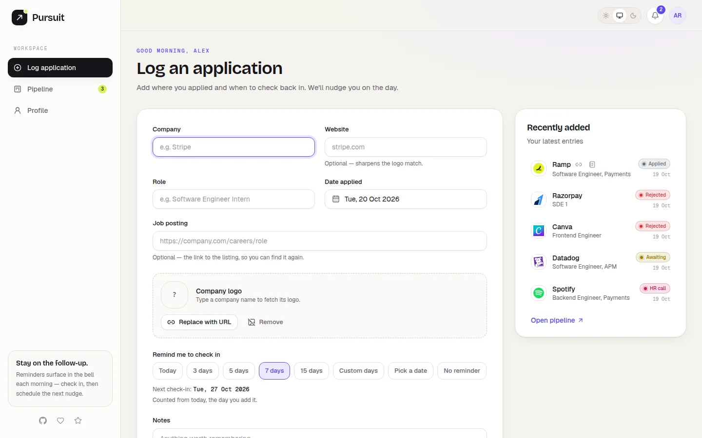
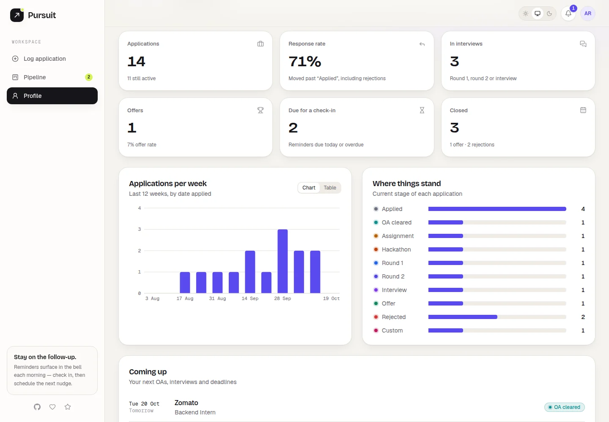
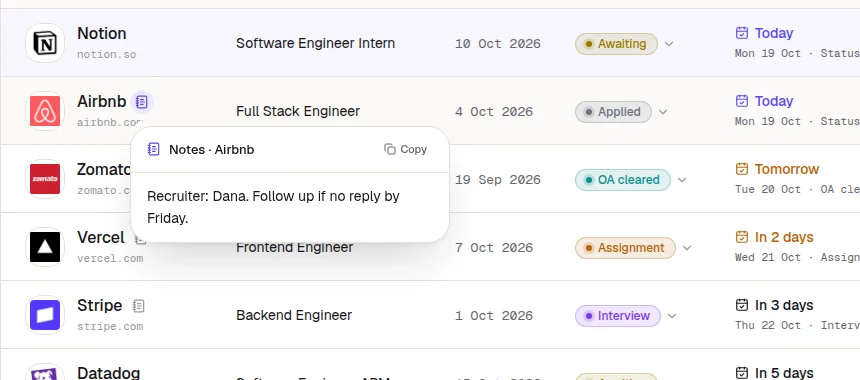
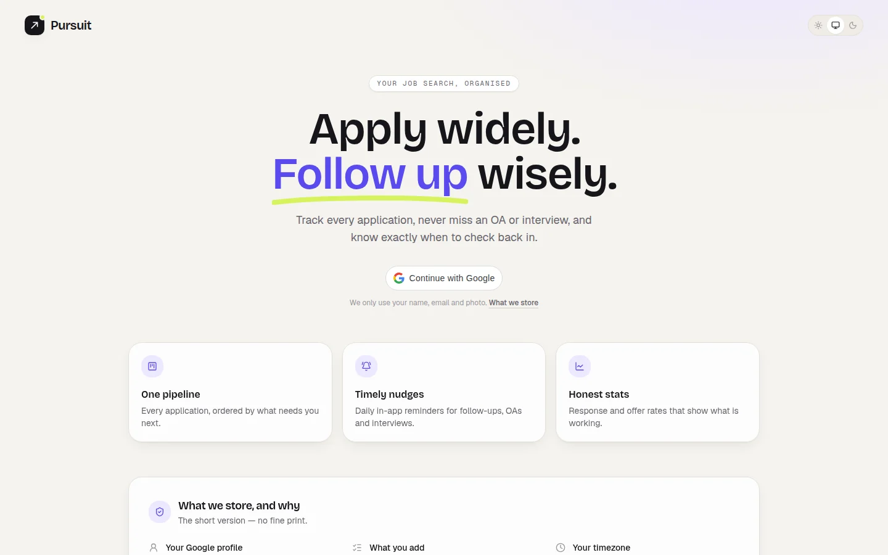
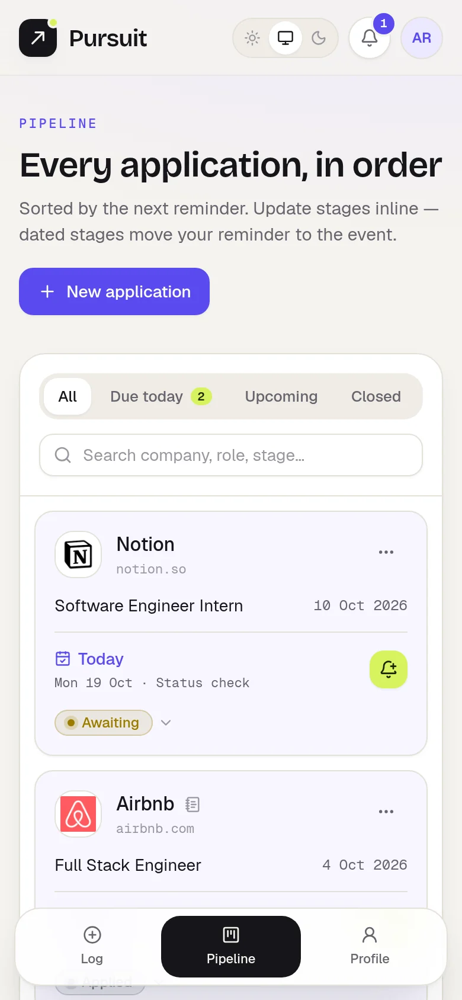
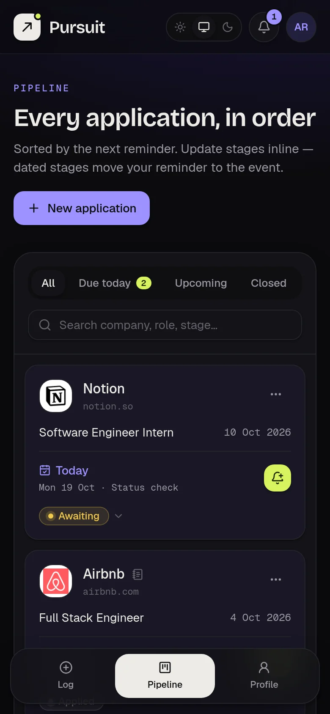

<div align="center">


# Pursuit

**Apply widely. Follow up wisely.**

A personal job-application tracker: log where you applied, move each application through its stages,<br />
and get a gentle in-app nudge on the day it's time to check back in.

<p>
  <a href="#-quick-start"><strong>Quick start</strong></a> ·
  <a href="#-features"><strong>Features</strong></a> ·
  <a href="#-how-reminders-work"><strong>Reminders</strong></a> ·
  <a href="#-contributing"><strong>Contributing</strong></a>
</p>

<p>
  <a href="https://github.com/krishnaj01/pursuit/actions/workflows/ci.yml"></a>
  
  
  
  
  
  
  <a href="#-copyright--usage"></a>
  <a href="https://github.com/krishnaj01/pursuit/stargazers"></a>
</p>

<picture>
  <source media="(prefers-color-scheme: dark)" srcset="docs/screenshots/pipeline-dark.webp" />
  
</picture>

</div>

## Why Pursuit?

Job hunting turns into a spreadsheet of forgotten follow-ups fast. Pursuit keeps it to the one question that matters each day — **what needs my attention today?** — and stays deliberately small: no job board, no resume builder, no feed. Just your applications, your timeline and your nudges.

## ✨ Features

| | |
|---|---|
| 🗂️ **One pipeline** | Every application in a single table, sorted by the next reminder. Filter by due, upcoming or closed, search, and page through 10 / 20 / 50 rows. Phones and tablets get a card layout. |
| 🔔 **Timely nudges** | A daily in-app digest lists everything due — worked out in *your* timezone. After checking in, schedule the next nudge in 3, 5, 7 or 15 days, pick a date, or turn it off. |
| 🧭 **Stages that move your reminders** | OA, assignment, hackathon, rounds, interview or your own custom stage. Dated stages ask for the date and move your reminder to it. **Awaiting** marks that you're waiting to hear back and asks when to follow up. Offers and rejections close an application. |
| 🕰️ **Editable timeline** | Every stage change is recorded. Fix a date, rename a custom stage, or remove an entry logged by mistake — the application stays in sync. |
| 🧩 **Browser extension** | Log from any job page in one click, or get prompted right after you apply on Greenhouse, Lever, Ashby or Workday. |
| 📝 **Notes & job links at a glance** | Save the job posting's link and your notes with each application. Small icons mark them in the pipeline — hover or tap to read notes or open the posting, with one-click copy. |
| 🏢 **Company logos** | Fetched once per company from logo.dev (falling back to Google favicons), stored as tiny 128 px WebP images and served from memory. Keep it, replace it with your own URL, or remove it. |
| 📊 **Honest stats** | Response and offer rates, applications per week, where things stand, and what's coming up. |
| 🔒 **Your data, your call** | Google sign-in, one httpOnly session cookie, no ads or tracking. Export everything as CSV or delete your account and all its data from your profile. |
| 🌗 **Light & dark** | A considered design system in both themes, with a system-follow option. |

## 📸 Screenshots

<table>
  <tr>
    <td width="50%">
      <picture>
        <source media="(prefers-color-scheme: dark)" srcset="docs/screenshots/log-dark.webp" />
        
      </picture>
      <p align="center"><sub><b>Log an application</b> — logo lookup and reminder presets</sub></p>
    </td>
    <td width="50%">
      <picture>
        <source media="(prefers-color-scheme: dark)" srcset="docs/screenshots/profile-dark.webp" />
        
      </picture>
      <p align="center"><sub><b>Profile</b> — stats, weekly activity and where things stand</sub></p>
    </td>
  </tr>
  <tr>
    <td width="50%">
      <picture>
        <source media="(prefers-color-scheme: dark)" srcset="docs/screenshots/notes-dark.webp" />
        
      </picture>
      <p align="center"><sub><b>Notes</b> — hover or tap the icon to read them</sub></p>
    </td>
    <td width="50%">
      <picture>
        <source media="(prefers-color-scheme: dark)" srcset="docs/screenshots/login-dark.webp" />
        
      </picture>
      <p align="center"><sub><b>Sign in</b> — with a plain-language privacy note</sub></p>
    </td>
  </tr>
</table>

<details>
<summary><b>On mobile</b></summary>
<br />
<p align="center">
  
  &nbsp;&nbsp;
  
</p>
</details>

<sub>Screenshots use demo data.</sub>

## 🧱 Tech stack

| Layer | Built with |
|---|---|
| **Frontend** | React 19 + TypeScript (Vite), Tailwind CSS v4, React Router, TanStack Query & Table, zustand, react-hook-form + zod, Radix UI, react-day-picker, Recharts, sonner |
| **Backend** | FastAPI, SQLAlchemy 2 (async) + asyncpg, Alembic, pydantic-settings, google-auth, PyJWT, httpx, Pillow |
| **Database** | PostgreSQL (any provider — local, Neon, Supabase, RDS…) |
| **Tooling** | uv, Ruff, pytest, oxlint |

## 🚀 Quick start

> [!NOTE]
> These steps are for running Pursuit locally to develop and contribute. Pursuit isn't open source — see [Copyright & usage](#-copyright--usage).

**You'll need:** Python 3.12+ with [uv](https://docs.astral.sh/uv/), Node 20+, a PostgreSQL database URL, and a Google OAuth client ID.

### 1. Create a Google OAuth client

1. In [Google Cloud Console](https://console.cloud.google.com/apis/credentials), go to **Credentials → Create credentials → OAuth client ID → Web application**.
2. Under **Authorized JavaScript origins**, add `http://localhost:5173` and `http://localhost`. No redirect URI is needed — sign-in uses Google's popup button.
3. Copy the client ID; it's used by both the backend and the frontend.

### 2. Run the backend

```bash
cd backend
cp .env.example .env              # then fill it in (see below)
uv sync
uv run alembic upgrade head
uv run uvicorn app.main:app --reload --port 8000
```

API docs live at <http://localhost:8000/docs>.

### 3. Run the frontend

```bash
cd frontend
cp .env.example .env              # set VITE_GOOGLE_CLIENT_ID
npm install
npm run dev
```

Open <http://localhost:5173>. In development, Vite proxies `/api` to the backend, so the session cookie is same-origin.

### Environment variables

<details>
<summary><b>backend/.env</b></summary>

| Variable | Required | Description |
|---|:---:|---|
| `DATABASE_URL` | ✅ | PostgreSQL URL. `postgres://` / `postgresql://` are switched to asyncpg automatically, and `sslmode=require` is handled for hosts like Neon. |
| `GOOGLE_CLIENT_ID` | ✅ | Your OAuth client ID. |
| `JWT_SECRET` | ✅ | At least 32 random characters: `python -c "import secrets; print(secrets.token_urlsafe(48))"` |
| `JWT_EXPIRE_MINUTES` | | Session length (default 7 days). |
| `COOKIE_SECURE` | | `true` in production (HTTPS-only cookie). |
| `FRONTEND_ORIGIN` | | The frontend's origin, for CORS (default `http://localhost:5173`). |
| `LOGO_DEV_PUBLISHABLE_KEY` | | [logo.dev](https://logo.dev) key for logos. Without it, Google favicons are used. |
| `LOGO_DEV_SECRET_KEY` | | Optional; enables company-name → website search. |

</details>

<details>
<summary><b>frontend/.env</b></summary>

| Variable | Required | Description |
|---|:---:|---|
| `VITE_GOOGLE_CLIENT_ID` | ✅ | Same OAuth client ID as the backend. |
| `VITE_API_BASE_URL` | | Keep `/api/v1` in development; set the full API URL if it's on another origin. |
| `VITE_DEV_API_PROXY` | | Where the dev server proxies `/api` (default `http://localhost:8000`). |

</details>

> [!TIP]
> After pulling changes, run `uv run alembic upgrade head` again. The backend logs a clear error at startup if the database is behind the code.

## 🔔 How reminders work

| When… | …the next reminder is |
|---|---|
| You add an application | today + the days you chose, a custom date, or none |
| It moves to a dated stage (OA, assignment, hackathon, rounds, interview, custom) | that event's date — unless you switch the reminder off |
| It moves to **Awaiting** (waiting to hear back) | the follow-up you pick: 3 / 5 / 7 / 15 days, a date, or none |
| It moves back to Applied | unchanged |
| It becomes an Offer or is Rejected | none — the application is closed |
| You click **Set next** / **Reschedule** | 3 / 5 / 7 / 15 days from today, a date you pick, or none |
| You edit the latest timeline entry's date | moves with it |
| You delete the latest timeline entry | back to the previous stage's event (if still upcoming), otherwise a check-in in 7 days |

"Today" is always *your* today: the browser's timezone is saved at sign-in. The day's digest is built the first time you open Pursuit that day, so there's no background job to run or keep alive.

## 🧩 Browser extension

Log an application straight from the job page: click the Pursuit icon and the company, role and
link are filled in — or turn on the optional auto-prompt to get a "Log this to Pursuit?" card
right after you submit on Greenhouse, Lever, Ashby or Workday. It warns about duplicates and
only ever saves on your click. Setup, development and Chrome Web Store publishing steps are in
[`extension/README.md`](extension/README.md).

## 🔒 Privacy

Pursuit stores only what it needs: your Google name, email and photo; the applications you add; and your timezone. Logo lookups send only a company name or website to logo.dev or Google's favicon service. There's one sign-in cookie and no analytics. You can export or delete everything from your profile at any time.

## 🗂️ Project structure

<details>
<summary>Show the layout</summary>

```
backend/
  app/
    api/v1/       routers: auth, account, applications, notifications, stats, logos
    core/         settings, JWT + Google token verification, dependencies
    db/           base model, async session, migration check
    models/       SQLAlchemy models
    schemas/      pydantic request/response models
    services/     reminders, timeline, notifications, logos, stats, account
  alembic/        migrations
  tests/          pytest suite
frontend/
  src/
    api/          React Query hooks per resource
    components/   ui primitives, layout, applications, stats, profile, auth
    lib/          API client, query keys, constants, helpers
    pages/        Login, Log application, Pipeline, Profile
    stores/       zustand: auth, theme, pipeline UI
    styles/       globals.css — every design token, light and dark
docs/screenshots/ images used in this README
```

</details>

## 🌐 Deploying (Render)

Pursuit runs as two Render services: a **Web Service** for the API and a **Static Site** for the frontend. The static site forwards `/api/*` to the API, so the browser only ever talks to one domain and the session cookie just works.

**Backend — Web Service**

| Setting | Value |
|---|---|
| Root Directory | `backend` |
| Build Command | `uv sync --locked --no-dev && uv run --no-sync alembic upgrade head` |
| Start Command | `uv run --no-sync uvicorn app.main:app --host 0.0.0.0 --port $PORT` |
| Health Check Path | `/health` |
| Environment | `DATABASE_URL`, `GOOGLE_CLIENT_ID`, `JWT_SECRET` (a new random value), `COOKIE_SECURE=true`, `FRONTEND_ORIGIN=https://<your-frontend>.onrender.com`, and the logo.dev keys |

**Frontend — Static Site**

| Setting | Value |
|---|---|
| Root Directory | `frontend` |
| Build Command | `npm ci && npm run build` |
| Publish Directory | `dist` |
| Environment | `VITE_GOOGLE_CLIENT_ID`, `VITE_API_BASE_URL=/api/v1` |

Then add two rules under the static site's **Redirects/Rewrites**, in this order:

| Source | Destination | Action |
|---|---|---|
| `/api/*` | `https://<your-backend>.onrender.com/api/*` | Rewrite |
| `/*` | `/index.html` | Rewrite |

Finally, add the frontend URL to the Google OAuth client's **Authorized JavaScript origins** and publish the OAuth consent screen. Migrations run in the build step; `alembic upgrade head` does nothing when the database is already up to date.

## 🤝 Contributing

**PRs are welcome!** Bug fixes, polish and small, focused features that keep Pursuit a *personal* tracker are all appreciated.

1. Fork the repo and create a branch: `git checkout -b feat/your-idea`
2. Make your change — match the existing style, and keep colours and spacing in the design tokens (`frontend/src/styles/globals.css`).
3. Run the checks:
   ```bash
   cd backend && uv run pytest && uv run ruff check .
   cd frontend && npm run lint && npm run build
   ```
4. If you changed a model, add a migration: `uv run alembic revision --autogenerate -m "describe it"`.
5. Open a pull request — the template will walk you through the rest. Screenshots help for UI changes. CI runs the same checks automatically on every PR.

By opening a pull request you agree to the [contribution terms](#contributions) below.

**Looking for an idea?** Some things that would fit nicely:

- A "where I found it" source (LinkedIn, referral, careers page…), with response rate by source
- A *ghosted* outcome, suggested when nothing changes for a while
- A duplicate warning in the Log application form (the extension already has one)
- Calendar (`.ics`) export for interviews and deadlines
- A kanban board view with drag-and-drop between stages

Found a bug or have a suggestion? [Open an issue](https://github.com/krishnaj01/pursuit/issues).

## 📜 Copyright & usage

**Copyright © 2026 Krishna Jhanwar. All rights reserved.**

This repository is public so you can read the code and contribute to it. It is **not open
source**: no license is granted to use, copy, modify or distribute it, apart from the limited
permissions below.

**You may**

- view and read the code on GitHub;
- fork the repository on GitHub, and run it locally, **only** to prepare a pull request to this
  repository.

**You may not, without prior written permission**

- copy, republish or redistribute this code — in whole or in substantial part — in another
  repository, package, website or product;
- deploy, host or offer Pursuit (or a modified version of it) as a service;
- sell, sublicense or otherwise commercialise it;
- present this project, or work derived from it, as your own;
- remove or alter this copyright notice.

### Contributions

By submitting a pull request, you confirm that the contribution is your own original work (or
that you have the right to submit it), and you grant Krishna Jhanwar a perpetual, worldwide,
irrevocable, royalty-free right to use, modify, distribute and relicense it as part of Pursuit.
You'll be credited in the project's history.

Want to use Pursuit in a way not covered here? [Open an issue](https://github.com/krishnaj01/pursuit/issues)
to ask for permission.

## 👋 Author

Built by **Krishna Jhanwar** — [GitHub](https://github.com/krishnaj01) · [X](https://x.com/krishna_jh01) · [Portfolio](https://www.krishnajhanwar.tech/)

If Pursuit helps your job hunt, a ⭐ on the repo goes a long way.
